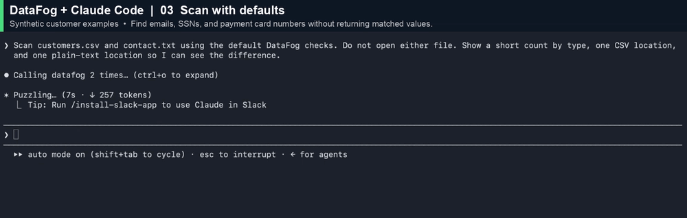
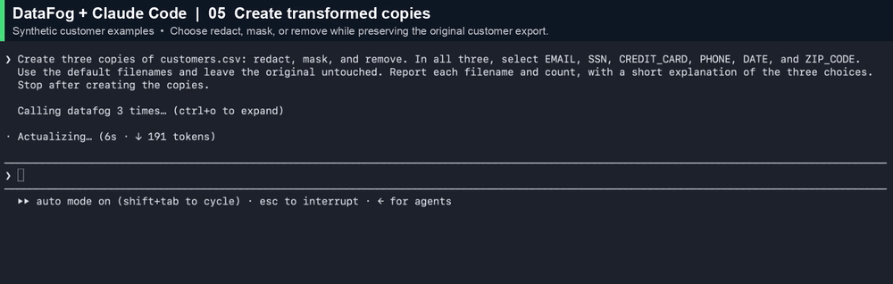

<p align="center">
  <a href="https://datafog.ai"></a>
</p>

<h1 align="center">DataFog MCP</h1>

<p align="center"><strong>Check sensitive files before an AI agent reads them.</strong></p>

<p align="center">
  <a href="https://pypi.org/project/datafog-mcp/"></a>
  <a href="https://pypi.org/project/datafog-mcp/"></a>
  <a href="https://github.com/DataFog/datafog-mcp/actions/workflows/ci.yml"></a>
  <a href="LICENSE"></a>
</p>

<p align="center">
  <a href="#quickstart">Quickstart</a> ·
  <a href="#see-it-in-action">Demos</a> ·
  <a href="docs/policy.md">Policy</a> ·
  <a href="docs/privacy.md">Privacy</a> ·
  <a href="CONTRIBUTING.md">Contributing</a>
</p>

DataFog MCP lets an AI agent detect personal data and credentials in local files, then create a copy with matched values redacted, masked, or removed. Detection runs on [DataFog Core](https://github.com/DataFog/datafog-core). Tool responses contain counts, locations, and copy paths—never file contents or matched values.

**Stable v1.0.0.** Tested with Claude Code. CI runs on Linux; development uses macOS. Windows and other MCP clients have not been validated.

## Quickstart

Requires **Python 3.10+** and [uv](https://docs.astral.sh/uv/).

**1. Install DataFog MCP.**

```bash
uv tool install datafog-mcp
```

**2. Choose which folders DataFog can access.**

```bash
datafog-mcp roots --edit
```

List one allowed directory per line, such as `~/Downloads/customer-exports`. Without a roots file or override, DataFog allows access to your home directory. Narrow this to the folders you need. [Allowed roots and owner policy →](docs/policy.md)

**3. Connect Claude Code.**

```bash
claude mcp add datafog --scope user -- "$(command -v datafog-mcp)"
```

Start a new Claude Code session and ask:

> Scan customers.csv with DataFog before opening it. Tell me what types of sensitive data you find, without reading the file into the conversation.

The MCP client must run on the machine that holds the files. A cloud-hosted agent cannot reach this local stdio server directly.

## See it in action

These clips use fictional customer records. Each shows a real Claude Code interaction with DataFog MCP. Try the [sample CSV](docs/demo/customers.csv) and [sample text file](docs/demo/contact.txt) inside an allowed folder.

### Scan a customer export

Find emails, SSNs, and payment card numbers without returning the matched values. CSV results include record and column locations; plain-text results include character offsets.



### Create a transformed copy

Choose **redact** (typed labels), **mask** (same-length replacement characters), or **remove** (delete matched values). The original stays intact, and existing copies are never overwritten.



The transform demo explicitly selects email, SSN, credit card, phone, date, and ZIP checks. An explicit selection **replaces** the defaults. Names remain in these copies; a clean rescan does not prove anonymity.

## Five tools, one local workflow

| Tool | Use it to |
|---|---|
| `datafog_policy` | Discover allowed roots, routine scope, output destination, and workflow guidance. |
| `datafog_scan` | Get finding types, counts, and locations. |
| `datafog_redact` | Replace matched values with labels such as `[EMAIL]`. |
| `datafog_mask` | Replace each matched value character for character. |
| `datafog_remove` | Delete matched values without leaving a marker. |

Scans return individual locations for up to **700 findings**. Above that, counts remain complete, but individual findings are omitted. Copies are saved beside the original by default, or in an owner-configured directory.

### Detection coverage

- **On by default:** email, SSN, credit card, labeled US routing numbers and NPIs, and supported credentials.
- **Opt in:** phone, date, ZIP code, and IP address.
- **Not detected:** plain-text names and street addresses.

Credential coverage includes GitHub and Stripe keys, bearer tokens, JWTs, password-bearing PostgreSQL URIs, and PEM private keys. Coverage varies by type; this is not a replacement for a dedicated secret scanner. [Detection and copy behavior →](docs/detection.md)

### Supported files

UTF-8 text files up to **10 MB**: CSV, TSV, JSON, logs, ENV, SQL, and plain text. CSV/TSV are processed as decoded cells; other formats use text matching with ENV/SQL email boundary handling.

CSV/TSV headers are preserved and not scanned by default. Use `has_header=false` when the first record should be processed as data. XLSX, PDF, DOCX, images, and archives are not parsed. A refused scan means the file was not checked. [File formats and limits →](docs/file-formats.md)

## Privacy and control

File contents are processed locally. The running server makes no network requests, and neither successful nor failed tool responses include file contents or matched values. Installation downloads packages separately.

Responses do include paths and metadata, which enter the agent's context and may reach its model provider. Allowed roots restrict **DataFog's** access; they do not restrict other agent tools. Routine scope and workflow settings are advisory. Detection can miss values, and approved allowlist values remain in copies.

[Privacy boundaries →](docs/privacy.md) · [Configure roots, scope, allowlists, and output folders →](docs/policy.md)

## Documentation and contributing

- [Detection and copy behavior](docs/detection.md)
- [Supported formats and limits](docs/file-formats.md)
- [Allowed roots and owner policy](docs/policy.md)
- [Privacy and security boundaries](docs/privacy.md)
- [Uninstall](docs/uninstall.md)
- [Development and local checks](docs/development.md)
- [Contributing and changelog policy](CONTRIBUTING.md)
- [Release process](RELEASING.md)
- [Changelog](CHANGELOG.md)

Report vulnerabilities through [SECURITY.md](SECURITY.md), rather than a public issue.

## License

[MIT](LICENSE). Built by [DataFog](https://datafog.ai).
